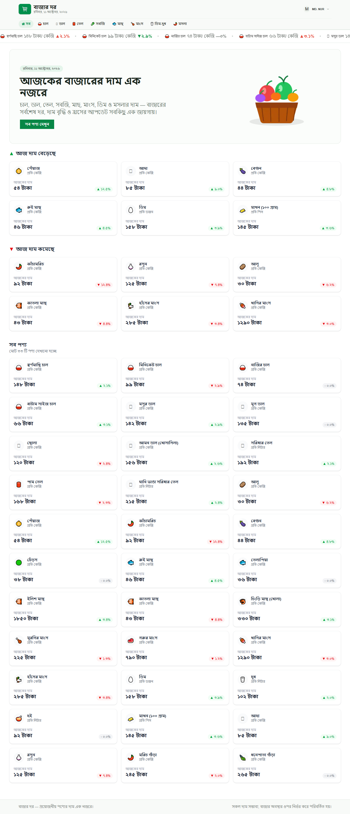

# React + Nextjs + Better Auth

# 🛒 বাজার দর | BazarDor

BazarDor is a modern web application that helps users explore daily market prices, track price changes, and make informed shopping decisions with ease.

## 🌐 Live Demo

🔗 [Live Site](https://bazar-dor-ochre-alpha.vercel.app/)

## 📂 Github Repository

🔗[Github Repository](https://github.com/nuruddin538/bazar-dor.git)

<!-- Add your project screenshot here -->

## 

## 📌 About The Project

**বাজার দর (BazarDor)** is a web-based market price tracking platform designed to make everyday shopping more transparent and convenient.

Users can explore essential products, compare available market prices, identify products with increasing or decreasing prices, and access detailed product information through a clean and responsive interface.

The project also provides user authentication and profile management for a personalized experience.

## ✨ Key Features

### 1. 📊 Daily Market Price Tracking

- Explore essential products and their available market prices.
- View product information in an organized layout.
- Make informed shopping decisions.

### 2. 📈 Price Increase & Decrease

- Discover products whose prices have increased.
- Explore products whose prices have decreased.
- Quickly identify daily price movements.

### 3. 🛍️ Product Details

- View detailed information about individual products.
- Explore market-wise price information.
- Check available price changes for products.

### 4. 🔐 Secure User Authentication

- User registration and login with Better Auth.
- Protect restricted pages from unauthenticated access.
- Provide authenticated access to user-specific features.

### 5. 👤 User Profile Management

- View personal profile information.
- Update account information.
- Manage user details through a dedicated profile interface.

## 🛠️ Technologies Used

| Technology                         | Purpose                                         |
| ---------------------------------- | ----------------------------------------------- |
| **Next.js**                        | Building the user interface and web application |
| **Next.js App Router**             | Page routing and navigation                     |
| **TypeScript**                     | Type safety and maintainable code               |
| **Tailwind CSS**                   | Responsive styling and modern layouts           |
| **DaisyUI / UI Component Library** | Reusable UI components and consistent design    |
| **Better Auth**                    | User authentication and session management      |

## 🚀 Getting Started

Follow these steps to run BazarDor on your local machine.

### Prerequisites

Make sure you have installed:

- [Node.js](https://nodejs.org/)
- npm (included with Node.js)
- Git

### Installation

**1. Clone the repository**

```bash
git clone <https://github.com/nuruddin538/bazar-dor.git>
```

**2. Navigate to the project directory**

```bash
cd bazar-dor
```

**3. Install dependencies**

````bash
npm install
```
**4. Configure environment variables**

Create a `.env` file in the root directory and add the environment variables required by your application and Better Auth configuration.

```env
BETTER_AUTH_SECRET=your-secret-key
BETTER_AUTH_URL=http://localhost:3000
```

> **Note:** Configure any additional database or authentication variables required by your project. Use the variable names specified in your actual application configuration, and never commit real secrets to GitHub.

**5. Start the development server**

```bash
npm run dev
```

**6. Open the application**

Visit [http://localhost:3000](http://localhost:3000) in your browser.


## 📂 Project Structure

A simplified overview of the project structure:

```text
bazar-dor/
├── public/                 # Static assets
├── src/
│   ├── app/                # App Router pages and layouts
│   ├── components/         # Reusable UI components
│   ├── lib/                # Utility functions and API helpers
│   └── types/              # TypeScript interfaces and types
├── .env                    # Environment variables (not committed)
├── package.json            # Dependencies and scripts
├── tsconfig.json           # TypeScript configuration
└── README.md               # Project documentation
```
> The structure above is illustrative. Adjust it to match your actual project folders.

## 🎯 Project Goals

- Make market price information easier to access.
- Improve transparency around everyday product prices.
- Help users understand price increases and decreases.
- Deliver a responsive and user-friendly experience.
- Practice modern web development with Next.js and TypeScript.

## 🔮 Future Improvements

- Historical price charts and trends.
- Market and location-based price comparisons.
- Product search and category filters.
- Price alerts and notifications.
- Additional market data and reporting.

## 🤝 Contributing

Contributions, suggestions, and feedback are welcome!

1. Fork the repository.
2. Create a new branch.
3. Make your changes.
4. Commit and push your changes.
5. Open a pull request.

```bash
npm run dev
# or
yarn dev
# or
pnpm dev
# or
bun dev
````

Open [http://localhost:3000](http://localhost:3000) with your browser to see the result.

You can start editing the page by modifying `app/page.tsx`. The page auto-updates as you edit the file.

This project uses [`next/font`](https://nextjs.org/docs/app/building-your-application/optimizing/fonts) to automatically optimize and load [Geist](https://vercel.com/font), a new font family for Vercel.

## Learn More

To learn more about Next.js, take a look at the following resources:

- [Next.js Documentation](https://nextjs.org/docs) - learn about Next.js features and API.
- [Learn Next.js](https://nextjs.org/learn) - an interactive Next.js tutorial.

You can check out [the Next.js GitHub repository](https://github.com/vercel/next.js) - your feedback and contributions are welcome!

## Deploy on Vercel

The easiest way to deploy your Next.js app is to use the [Vercel Platform](https://vercel.com/new?utm_medium=default-template&filter=next.js&utm_source=create-next-app&utm_campaign=create-next-app-readme) from the creators of Next.js.

Check out our [Next.js deployment documentation](https://nextjs.org/docs/app/building-your-application/deploying) for more details.
